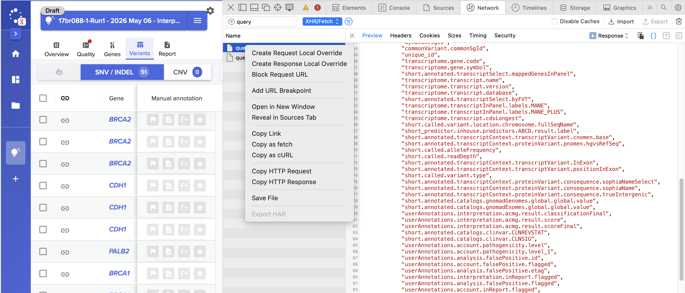

# Variant Query Service — Hackathon API Reference

## What is this service?

The **Variant Query Service (VQS)** is a query engine over genomic variant datasets produced by Sophia Genetics' NGS pipelines. Under the hood it is a multi-tenant wrapper around **DuckDB** that exposes a uniform JSON API for browsing, querying and filtering tabular data.

It can:
- **Sort, filter, paginate** large variant tables interactively
- **Join live data** (e.g. user annotations, phenotypic ranking) on top of the base dataset via composable *transformers*
- **Cache and materialize** datasets for faster repeated access
- **Export** filtered results as TSV / CSV
- Operate on **any tabular dataset**, not just variants — it is essentially "DuckDB as a service"

A query targets a `Dataset` identified by a **`key`** (resolved by the Genomic Data service in production), optionally chains one or more **transformers** that modify or enrich the data, and then runs a **query body** describing columns / filters / sort / pagination.

---


## Useful resources for the hackathon

We provide over 30 different resources through VQS to the front-end, allowing also to join different internal and external data to the pipeline results.

For the scope of the hackathon, the following are the most important queries:

- Gene table: Summarizes the variants that were found in the analysis, their classification and disease relevance
- Variants table: Shows the details on each of the variants (we provide over 500 points of information per variant in the data!)

The actual queries that are sent are depending on the analysis and interpretation. The best way to get started is to find a query of interest sent from the front-end, and modifying that.

### Steps
1. Go to the variants or gene view table
2. Open the browser developer tools, check in the network tab
3. Clear any entries that are there, and scroll until you see a new query that was sent
4. Click to see the details and 'Copy as cURL'



Example query:

```bash
curl 'https://platform-vandv1.sophiagenetics.com/api/variant/query?key=eyJmaWNJZCI6MjA2NTA3NTM4LCJrbm93bkZpbGUiOiJMQVlFUjJfU0hPUlRfU1VCU0VUX0RBVEFTRVRfUExVU19HRU5FX0FOTk9UQVRJT05TIiwiYW5hbHlzaXNJZCI6MjAwMDQyMzYwLCJpbnRlcnByZXRhdGlvbiI6ImludGVycHJldGF0aW9uLTEwNDIiLCJ0cmFuc2NyaXB0U3RyYXRlZ3lWZXJzaW9uIjoiMTc3ODA2OTAyNjAwMCJ9&engine.paginate=true&plan.parameters.uaVariantId=COMMON_SGID&plan.parameters.experimentTypeId=126000&plan.parameters.pmiId=200040484&plan.parameters.analysisId=200042360&plan.parameters.interpretationId=interpretation-1042&plan.transformers=FLATTEN%2CUSER_ANNOTATIONS%2CPHENOTYPIC_RANKING%2CUSER_ANNOTATIONS_REFRESH%2CPHENOTYPIC_RANKING_REFRESH%2CSHORT_SUBSET&engine.maxPaginationRows=500&plan.parameters.uaAcmgOverrideVersion=0&plan.parameters.uaAcmgCnvOverrideVersion=0&plan.parameters.uaVariantInReportVersion=0&plan.parameters.uaFalsePositiveVersion=0&plan.parameters.uaVariantDescriptionVersion=0&plan.parameters.uaPathogenicityVersion=0&plan.parameters.interpretationEtag=10075&plan.parameters.uaMrdMarkerVersion=0' \
-X 'POST' \
-H 'Content-Type: application/json' \
-H 'Accept: */*' \
-H 'Authorization: Bearer <token>' \
--data-raw $'{"columns":["\\"dynamic.sgId\\"","\\"commonVariant.commonSgId\\"","concat(\\"dynamic.sgId\\", \'-\', \\"transcriptome.gene.code\\") as unique_id","\\"transcriptome.gene.code\\"","\\"transcriptome.gene.symbol\\"","\\"short.annotated.transcriptSelect.mappedGenesInPanel\\"","\\"transcriptome.transcript.name\\"","\\"transcriptome.transcript.version\\"","\\"transcriptome.transcript.database\\"","\\"short.annotated.transcriptSelect.byFVT\\"","\\"transcriptome.transcriptInPanel.labels.MANE\\"","\\"transcriptome.transcriptInPanel.labels.MANE_PLUS\\"","\\"transcriptome.transcript.cdsLongest\\"","\\"short.called.variant.location.chromosome.fullSeqName\\"","\\"short_predictor.inhouse.predictors.ABCD.result.label\\"","\\"short.annotated.transcriptContext.transcriptVariant.cnomen.base\\"","\\"short.annotated.transcriptContext.proteinVariant.pnomen.hgvsRefSeq\\"","\\"short.called.alleleFrequency\\"","\\"short.called.readDepth\\"","\\"short.annotated.transcriptContext.transcriptVariant.InExon\\"","\\"short.annotated.transcriptContext.transcriptVariant.positionInExon\\"","\\"short.called.variant.type\\"","\\"short.annotated.transcriptContext.proteinVariant.consequence.sophiaNameSelect\\"","\\"short.annotated.transcriptContext.proteinVariant.consequence.sophiaName\\"","\\"short.annotated.transcriptContext.proteinVariant.consequence.trueIntergenic\\"","\\"short.annotated.catalogs.gnomadGenomes.global.global.value\\"","\\"short.annotated.catalogs.gnomadExomes.global.global.value\\"","\\"userAnnotations.interpretation.acmg.result.classificationFinal\\"","\\"userAnnotations.interpretation.acmg.result.score\\"","\\"userAnnotations.interpretation.acmg.result.scoreFinal\\"","\\"short.annotated.catalogs.clinvar.CLNREVSTAT\\"","\\"short.annotated.catalogs.clinvar.CLNSIG\\"","\\"userAnnotations.account.pathogenicity.level\\"","\\"userAnnotations.account.pathogenicity.level\\"","\\"userAnnotations.analysis.falsePositive.id\\"","\\"userAnnotations.account.falsePositive.flagged\\"","\\"userAnnotations.analysis.falsePositive.etag\\"","\\"userAnnotations.interpretation.inReport.flagged\\"","\\"userAnnotations.analysis.falsePositive.flagged\\"","\\"userAnnotations.account.inReport.flagged\\"","\\"userAnnotations.account.variantDescription.flagged\\""],"filters":{"filterString":"fql:(((transcriptome.gene.code anyOf (37370,23527,8298,5585,7006,32283,24498,28413,1183,23129,31155,15907,8208,38546,5579,37414,6701,28094,1779,21512,39462,9156,19155,13892,36793,30171,31024,29230,2235,30099,35387,31869,13735,34856,38283,16374,18478,15085,9244,20991,38520,24750,19482,30442,16939,26450,24194,10758,29842,35212,34563,32582,1310,656,37237,6646,4306,32546,17273,4760,40111,38872,20483,4123,18244,9336,3750,20769,33181,40998,27835,7151,14926,2338,38918,621,105,7701,4114,37226,39800,37942,36812,18889) AND transcriptome.transcriptInPanel.geneInPanel = true) OR (short.annotated.transcriptContext.proteinVariant.consequence.sophiaName = \'intergenic\' AND transcriptome.gene.symbol is empty)) AND short.called.filter.bool.PASS is true)"},"groupBy":["*"],"pagination":{"offset":50,"limit":50},"columnSorts":[{"column":"\\"short_predictor.inhouse.predictors.ABCD.result.label\\"","sort":"ASC"},{"column":"\\"dynamic.sgId\\"","sort":"ASC"}]}'
```

Based on this, you can test the query in the terminal, and modify the body as defined below.

---

## Base URL

All endpoints below are served under the configurable context path:

```
http://<host>/api/variant/query
```

## Authentication

Every endpoint requires authentication. Pass a bearer token in the `Authorization` header:

```
Authorization: Bearer <IAM_TOKEN>
```

The IAM_TOKEN you can get from https://iam-vandv.sophiagenetics.com/account/token , field `access_token`, or by checking the requests sent from the front-end to the service. Any token there will be valid for 1 hour.

(Screenshot of the token page removed.)

---

## Common request parameters (you shouldn't have to change them)

All endpoints accept the same `parameters` query object (flattened as `parameters.*` query string entries):

| Field | Type | Required | Description |
|-------|------|----------|-------------|
| `parameters.key` | string | yes | The dataset key (resolved by the configured `DatasetProvider`). |
| `parameters.plan.transformers` | string | no | Comma-separated list of `DataTransformerKey` values applied to the base dataset, in order. Modifes the data by joining external data sources. |
| `parameters.plan.parameters.*` | map | no | Free-form parameters consumed by the transformers (e.g. `analysisId`, `interpretationId`, version flags…). |
| `parameters.engine.*` | object | no | Optional engine tuning parameters. |

---

---

### The `Query` body

The POST endpoints take a JSON `Query` body:

```json
{
  "columns":     ["*"],
  "groupBy":     null,
  "filters":     { "filterString": "" },
  "columnSorts": [
    { "column": "chr", "sort": "ASC", "nullsFirst": true }
  ],
  "pagination":  { "offset": 0, "limit": 100 }
}
```

This translates in the backend to an SQL that is executed on the data. Please make sure to escape any columns that contain a dot or another special character, for example `"\"short.annotated.transcriptContext.proteinVariant.consequence.trueIntergenic\""`.

| Field | Type | Notes |
|-------|------|-------|
| `columns` | `string[]` | Columns to return. Use `["*"]` for all. The controller currently always uses default columns server-side. |
| `groupBy` | `string[]` | Optional grouping columns. |
| `filters.filterString` | string | Free-form filter expression in a custom FQL format (not SQL, to prevent SQL injections). |
| `columnSorts[]` | array | `column` + `sort` (`ASC`/`DESC`) + optional `nullsFirst`. |
| `pagination.offset` | int | Defaults to `0`. |
| `pagination.limit` | int | Defaults to `1000` if omitted. |

---

### Filter expression syntax (FQL)

`filters.filterString` accepts an FQL expression, prefixed with `fql:`. Each leaf is `column <operator> <value>`; leaves are combined with `AND` / `OR` and grouped with parentheses. String values use single quotes; column names with dots must be quoted (e.g. `"short.called.alleleFrequency"`). String comparisons are case-insensitive.

Append `?` to any operator (e.g. `=?`, `anyOf?`, `between?`) to also match `NULL` rows.

| Operator | Meaning | Example |
|---|---|---|
| `=`, `!=` | equals / not equals | `gene.code = 'BRCA1'` |
| `<`, `<=`, `>`, `>=` | numeric comparison | `alleleFrequency >= 0.05` |
| `~`, `!~` | contains / does not contain (substring) | `"gene.symbol" ~ 'BRCA'` |
| `=~`, `~=` | starts with / ends with | `transcript.name =~ 'NM_'` |
| `is empty`, `is not empty` | NULL check | `pathogenicity is not empty` |
| `anyOf (...)`, `noneOf (...)` | value in / not in list | `"gene.code" anyOf (123, 456)` |
| `between (min, max)`, `outside (min, max)` | numeric range | `readDepth between (20, 200)` |
| `anyOfList`, `containsAllOf`, `allOf` (and `not...` variants) | match against composite/array string columns | `labels anyOfList ('mane','clinvar')` |

Combine with `AND` / `OR` and parentheses:

```text
fql:(("gene.code anyOf" (123,456) AND "transcriptInPanel.geneInPanel" = true)
     OR "consequence.sophiaName" = 'intergenic')
    AND "filter.bool.PASS" is true
```

---

## Endpoints

### 1. `GET /schema`

Return the column schema of the resolved dataset (after applying transformers).

**Query params:** the standard `parameters.*` block above.

**Response 200** — `DataSchema`:

```json
{ "columns": ["chr", "pos", "ref", "alt", "..."] }
```

**Example:**

```bash
curl -G "https://platform-vandv1.sophiagenetics.com/api/variant/query/schema" \
  --data-urlencode "parameters.key=user_annotations" \
  --data-urlencode "parameters.plan.transformers=USER_ANNOTATIONS,MATERIALIZE" \
  -H "Authorization: Bearer $IAM_TOKEN"
```

---

### 2. `POST /` — paginated query

Run a single query against the dataset and return one page of results.

**Query params:** `parameters.*`
**Body:** a `Query` (see above).

**Response 200** — `Page`:

```json
{
  "header": {
    "offset": 0,
    "key": "user_annotations",
  },
  "pageContent": {
    "columns": ["chr", "pos", "ref", "alt"],
    "data":    [["1", 12345, "A", "G"], ["1", 23456, "C", "T"]]
  }
}
```


**Example:**

```bash
curl -X POST "https://platform-vandv1.sophiagenetics.com/api/variant/query?\
parameters.key=user_annotations&\
parameters.plan.transformers=USER_ANNOTATIONS&\
parameters.plan.parameters.analysisId=1&\
parameters.plan.parameters.interpretationId=1&\
parameters.plan.parameters.experimentTypeId=126000" \
  -H "Authorization: Bearer $IAM_TOKEN" \
  -H "Content-Type: application/json" \
  --data '{
    "columns": ["*"],
    "filters": { "filterString": "" },
    "columnSorts": [],
    "pagination": { "offset": 0, "limit": 100 }
  }'
```

